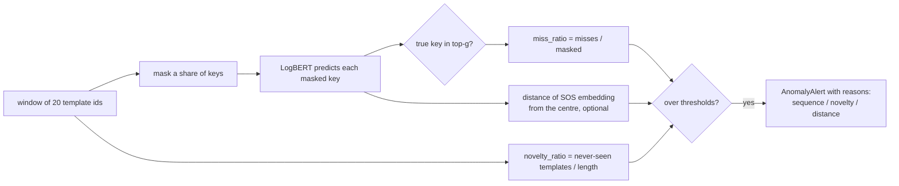
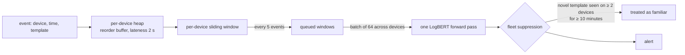

# Anomaly detection (LogBERT)

logpipe models **sequences of template ids** per device or stream with LogBERT (Guo et al.,
IJCNN 2021), vendored and adapted in `logpipe/anomaly/logbert/`. Keyword rules catch
known-bad lines; LogBERT catches *unusual order, missing steps, bursts and stuck loops* in
lines that each look normal.

## Model

| Part | Default | Code |
|---|---|---|
| Vocabulary | template ids → keys, plus `[PAD]`, `[SOS]`, `[MASK]`, `[UNK]` | `anomaly/vocab.py` |
| Encoder | BERT, hidden 64, 2 layers, 4 heads, max length 128, dropout 0.1 | `logbert/model.py` |
| Objectives | masked log-key prediction + hypersphere (`[SOS]` embedding near the centre) | `logbert/trainer.py` |
| Windows | 20 events, stride 5, minimum length 5 | `detector.py:DetectorConfig` |

Ids are **canonical** (aliases resolved), so a firmware rewording that was linked to the old
template is the same token to the model.

## Scoring a window

- **`miss_ratio`**: LogBERT's own criterion. Most masked keys missing from the top-g predictions
  means the sequence isn't one the model knows.
- **`novelty_ratio`**: a separate signal added here. A never-seen event type is often the
  clearest anomaly on a device; the original blueprint masked unknowns, which hides it. The
  ablation (`unknown_mode = unk | mask | drop`) shows the effect: on BGL, F1 with novelty is
  **0.95**, and without it 0.87 (`unk`), 0.40 (`mask`) or 0.39 (`drop`).
- **Thresholds** (`scorer.py:tune_thresholds`): grid search for F1 on a *validation* split. The
  original tuned on the test set, which overstates F1; the eval reports both. Without labels
  (the server), a stream's threshold is the 99th percentile of the miss ratio on held-out normal
  windows (at least 0.3), and novelty is set to `inf`: unknown templates become a
  *retrain item* in Maintenance, not an alert.

## The streaming detector

`anomaly/detector.py`:

- **Reorder buffer.** Device clocks drift and MQTT reorders across reconnects, so events wait
  until older than (newest − lateness).
- **Batching.** One forward pass per 64 windows across devices, not one per event.
- **Fleet suppression.** A template that appears on many devices over a while is a rollout, not
  an anomaly. On the IoT fleet this cuts novelty false positives from 2,597 to 479 and lifts F1
  from 0.34 to 0.56 ([results](../benchmarks/results.md#iot-fleet-end-to-end)).

## In the server: per-stream models

A **stream** is a named list of `host` / `service` / `source` globs. Each trains its own
LogBERT on capped per-source sequences. A model needs 8 windows (20 consecutive parsed lines
from one source); with less, the stream waits with a have/need meter. Retraining runs on
request, or when a model is older than `retrain_days` (7) **and** has templates it hasn't seen.

**Drift.** Training keeps a histogram of how much of each held-out window the model missed;
live windows feed a rolling histogram per stream (the last 2,000). The PSI between the two
says how far traffic has moved: < 0.1 stable, 0.1–0.25 moderate, > 0.25 retrain.

## Where its scores go

- `anomaly_alerts` (ClickHouse) or the store's alert list: windows over threshold, with
  `miss_ratio`, `novelty_ratio`, reasons and template ids.
- **Incidents**: alerts on one service closer than 5 minutes are grouped into one incident.
- **RCA**: `scorer.explain(window)` re-reads the anchor service's last lines and marks each
  `expected | unexpected | unseen`; the share of surprises becomes a candidate's anomaly
  factor ([Ask & RCA](ask-rca.md)).

## Log volume: silence, drops and spikes

LogBERT judges the order of lines, so a service that stops logging gives it nothing to judge.
Each source (`host` / `service` / `source`) also gets a volume model on its lines per minute,
counted by the lines' own time and judged two minutes after the minute ends
(`logpipe/anomaly/volume.py`, after Miller, *Holt-Winters Forecasting Applied to Poisson
Processes in Real-Time*):

- **Forecast.** Holt-Winters with a level and an hour-of-week season, no trend.
- **How unlikely.** A negative binomial around the forecast: Poisson plus a learned
  overdispersion, since logs come in bursts.
- **Drop or spike.** 3 minutes in a row that are both improbable (p < 0.001) and far off
  (under half, or over twice and 10 lines more than expected). A 3% dip of a busy source is
  improbable but not an alert.
- **Silence.** Tested over the whole run of empty minutes (p < 10⁻⁶, at least 3 minutes). A
  source sending 100 lines a minute is flagged after 3 minutes; one sending a line every two
  minutes takes about half an hour, since it can't be told apart from a quiet spell sooner.
- **Learning.** For the first two days a model only alerts on silence, learning each hour for
  every day of the week. After that, unusual minutes are not learned, so an outage never
  becomes normal. **This is normal** on a volume warning makes its model take the current
  volume as normal and learn again. A warning closes by itself once the volume is back.

**Ingestion first.** A drop is only a service problem if the logs could have arrived. A host
gets an `ingestion` warning instead, and its sources are neither judged nor learned until
5 minutes after it recovers, when:

| Signal (agent heartbeat) | Meaning |
|---|---|
| agent not reporting in | agent, network or server problem |
| `shipper.buffer_bytes` > 0 | logs read but waiting to be sent |
| a file source's `scanned_at` over 60 s old | its reader is stuck |
| a file source's `partial_since` over 60 s old | the last line is waiting for its newline |

The same 5 minutes apply to every host after the server starts or stalls: agents send what
they buffered in a burst. Sources from outside an agent (OTLP, Datadog) have only the volume
signal.
