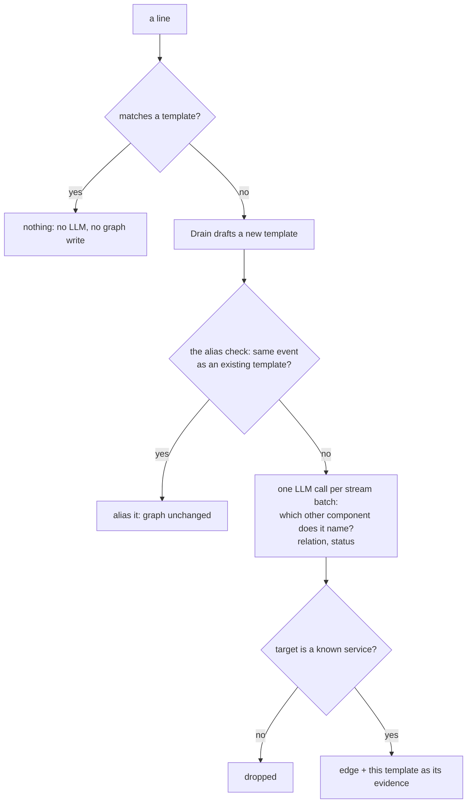

# Component graph

`logpipe/graph/` keeps a graph of **which service depends on which**, learned from the log
templates themselves. It follows *Log2Graph* (Amanmadov & Abdullayev, *From Logs to Knowledge:
LLM-Powered Dynamic Knowledge Graphs for Real-Time Cloud Observability*, IJACSA 16(10), 2025):
an LLM turns telemetry into `(entity, relation, entity)` triples, a registry of known components
rejects what it made up, a graph database holds the result, and questions run over it.

Two changes make it fit logpipe:

- **Once per template, not once per line.** The paper parses every line with an LLM. Lines of
  one template only differ in their variables, so logpipe asks once per new template, in a batch
  per stream, and a line never reaches the LLM.
- **No failure samples, no retraining.** Unlike LogKG-style methods, nothing is learned from
  labelled incidents. The graph says how things connect; the anomaly signals (LogBERT, volume,
  rarity, new errors) still say what's wrong.

## When it changes

- **First calibration and new sources** (the draft job): each draft carries its proposed links,
  the Review page shows them, and approving the batch publishes templates and links together. The
  first calibration's answers are cached with its drafts (`LOGPIPE_DRAFT_CACHE`, the showcase's
  `showcase-drafts-<llm>.json`), so a cached run asks nothing.
- **Templates the online learner adds** are labelled by the housekeeping loop as soon as the
  registry version moves.
- Without a chat model, a template's links are the known services it names (the **rule
  baseline**, also a benchmark variant).

A label is stored per `(service, template)` (control doc `graph_label`). The edges are derived
from all labels, the services that exist now and the edits made by hand (`graph_edit`), so a
service that appears later still gets the links an earlier label proposed, and an edge removed
by hand stays removed.

## What's stored, what's read

| | where | when |
|---|---|---|
| components and links (+ evidence templates, who learned it) | Neo4j (`NEO4J_URI`), else memory | derived again when labels or edits change |
| how a link looks now (lines, error/warn lines) | the log store | when someone looks: its evidence templates' counts |

A template holds both a 200 and a 502, so a link's errors are its templates' error/warn lines
counted apart, not the level of the template. Health: idle (no lines), ok, warn (< 20 % errors),
error.

Neo4j holds `(:Component {name})-[:LINK {relation, templates, by, status}]->(:Component)`. Every
read is a fixed, parameterised Cypher statement (`graph/store.py`); the LLM never writes Cypher.

## Where it's used

- **Topology page**: callers on the left, dependencies on the right, links coloured by health.
  Click a component for what breaks if it fails; click a link for its evidence templates; add
  or remove a link by hand.
- **Ask, dependency questions**: "what breaks if postgres fails?", "what does shop-api depend
  on?", "how are nginx and postgres linked?" route to a `graph` intent (a regex fast path, else
  the LLM router) and answer as a table straight from the graph, without reading lines.
- **RCA**: the evidence round reads the graph around the anchor's service (`G1…` refs in the
  bundle, cited like lines). A candidate on a service the anchor's service depends on, if it's an
  error, a warning or new there, is multiplied by `1 + graph_weight / hops`: a cause sits below
  its symptoms. With no service at the anchor, the focus is the top error's service. The LLM can
  ask for more of it with a `graph` follow-up move.

| setting | default | |
|---|---|---|
| `NEO4J_URI` / `NEO4J_USER` / `NEO4J_PASSWORD` | unset / neo4j / — | unset: in memory |
| `LOGPIPE_GRAPH_ENABLED` | true | |
| `LOGPIPE_GRAPH_BATCH` | 40 | templates per labelling call |
| `LOGPIPE_RCA_GRAPH_WEIGHT` | 1.0 | 0 turns the ranking factor off |
| `LOGPIPE_RCA_GRAPH_DEPTH` | 2 | hops in the bundle's slice |

`docker compose --profile graph up -d neo4j` starts Neo4j (the server image has the driver).

## Limits

- A dependency no log line names is invisible: nginx shows its backend only if its log format
  has `$upstream_addr`. Add it by hand on the Topology page.
- Links end at known services only; an external API (a payment gateway) is dropped.
- `graph.all()` reads the whole graph when the anchor has no service; fine for tens of services,
  capped at 60 links.

Results: [Benchmarks → component graph](../benchmarks/results.md#component-graph).
