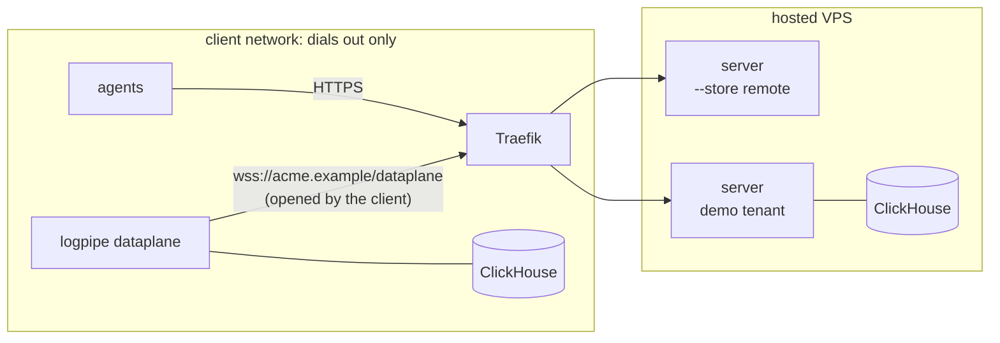

# Deploying tenants (and keeping a client's data at the client)

One file describes every host. `logpipe deploy render` turns it into the compose files and
`.env` each host runs, and `deploy/ansible/platform.yml` starts the hosted side.

To try the split on one machine first, `logpipe start` (or `logpipe showcase`) → *server* →
*at the client* runs `server --store remote` with a `logpipe dataplane` beside it.



## The topology

```yaml
domain: logpipe.example.com
images: ghcr.io/katovu
tag: latest

tenants:
  demo:                      # everything on the VPS
    residency: hosted
    llm: offline
    components: [parse, store, detect, graph]
  acme:                      # the rows stay on acme's network
    residency: client
    llm: llm:anthropic
    components: [parse, store, detect, enrich, graph]
```

| Field | Values | What it does |
|---|---|---|
| `residency` | `hosted` (default), `client` | where the tenant's rows, review samples and settings live |
| `components` | `parse`, `store`, `detect` (always), `enrich`, `graph` | `enrich` is the LLM (masks, key names, aliases, Ask); without it the LLM is off. `graph` is the [component graph](../architecture/graph.md) |
| `llm` | `offline`, `llm:<provider>[:<model>]`, … | as in [Set up an LLM](../getting-started/llm.md); needed by `enrich` |

Each tenant gets its own server container at `https://<tenant>.<domain>`, so tenants share
nothing but the VPS. Tenant names become hostnames: lowercase letters, digits and `-`.

## Deploy

```sh
cp deploy/topology.example.yaml deploy/topology.yaml        # edit it
uv run logpipe deploy render deploy/topology.yaml --out deploy/out
# put LLM keys (ANTHROPIC_API_KEY, …) in deploy/out/hosted/.env
cd deploy/ansible
ansible-playbook -i inventory.ini playbook.yml              # once: Docker + Traefik
ansible-playbook -i inventory.ini platform.yml              # after every render
```

Then hand `deploy/out/client-<tenant>/` to each client-residency tenant. Its README says what to
run (`docker compose up -d`); their server waits for that dataplane before it starts serving.

`deploy/out/` is gitignored: it holds the generated secrets. `secrets.env` there is reused by
every render, so re-rendering never rotates a key or a password. Delete a line from it to
rotate that one secret, then render and deploy both sides.

## How a client keeps their data

The client's network only lets connections out. `logpipe dataplane` runs beside the client's
ClickHouse and opens a WebSocket to their server (`--store remote`). The server sends its store
calls down that connection: insert these parsed rows, read the Log Explorer page, run this
query. So nothing on the VPS ever connects into the client's network.

- **The calls are a fixed list.** The dataplane answers only the store's own methods
  (`server/dataplane.py:METHODS`). Free-form SQL goes through the read-only ClickHouse user,
  as it does on the Query page. Values travel as JSON with a fixed set of types: no pickle,
  so neither side can make the other run code.
- **One key per tenant.** The connection carries `LOGPIPE_DATAPLANE_KEY`, generated by the render
  and present only in that tenant's two `.env` files.
- **When the dataplane is down,** intake answers 429 and the agents keep the logs on their disk
  until it is back (up to their buffer cap; past it they drop the oldest batches). The UI shows
  503 "the client's data is unreachable". Writes already accepted wait in memory and are sent
  on reconnect.

### What the hosted server keeps

It parses each line, sends the row on and keeps nothing on disk that came from a line:

| Kept on the VPS | Why |
|---|---|
| the template registry (`registry.json`) | parsing needs it on every line. Templates are line shapes with the variable parts masked, though a constant token (a hostname, a path) stays as written |
| LogBERT models per stream | trained on template id sequences, not text |
| `server.log` | the server's own operational log |

The review sample of a draft batch and Ask's query results, which other modes write to
`data_dir`, go to the client's control docs instead. `server --store remote` refuses Kafka
(it would hold unparsed lines on the VPS), Datadog (it would send lines and LLM prompts there)
and `LOGPIPE_DRAFT_CACHE`. `tests/test_dataplane.py` sends lines with a marker through a whole
draft cycle and checks no file on the hosted side contains it.

**The LLM still sees sample lines.** With `enrich`, the server sends a few lines per new
template, and Ask's evidence, to the LLM provider in the tenant's `llm:`. That is use, not
storage, but it leaves your VPS: pick a provider whose retention terms suit the client, or
leave `enrich` out (or run a local model) for a client who must not have any line leave.

## Without the render

The two halves are plain commands, if you'd rather wire them yourself:

```sh
# hosted
LOGPIPE_DATAPLANE_KEY=... logpipe server --store remote --queue memory   # tunnel on :8090
# client
LOGPIPE_DATAPLANE_KEY=... LOGPIPE_DATAPLANE_URL=wss://acme.example.com/dataplane \
    logpipe dataplane --store clickhouse
```

`LOGPIPE_DATAPLANE_PORT` moves the tunnel's port, and `LOGPIPE_DATAPLANE_TIMEOUT` sets how long
one call may take on the client side (60 s).
